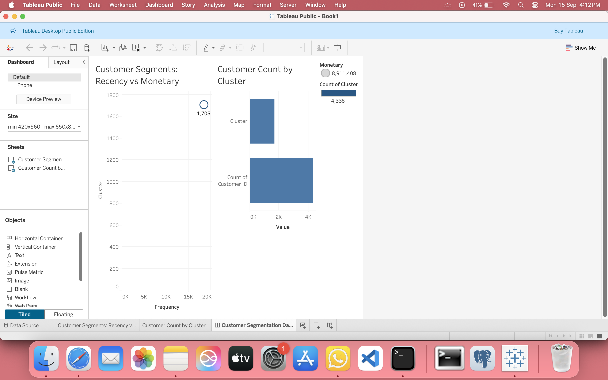
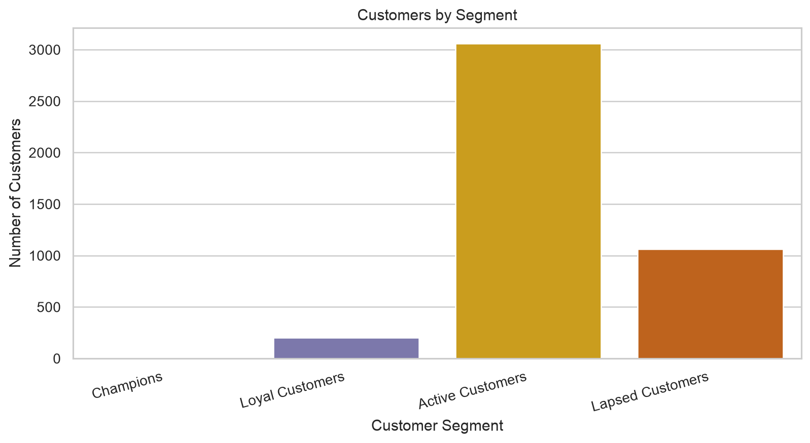
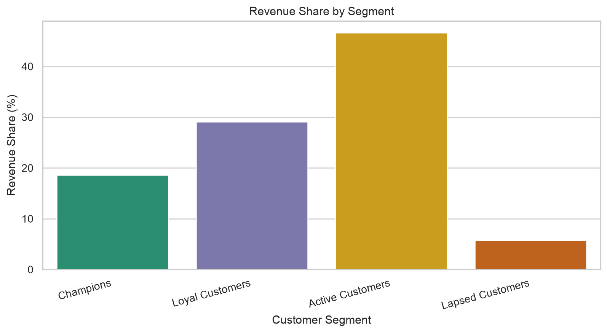
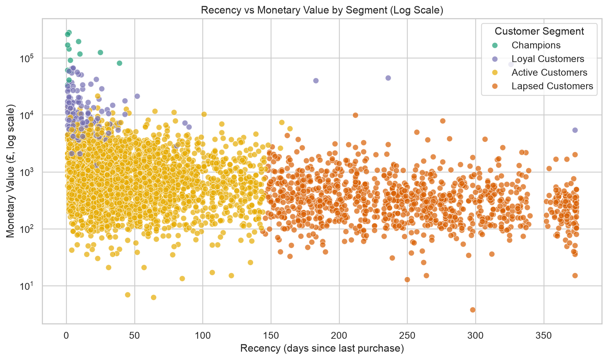

# Customer Segmentation Using RFM Analysis

## Business Problem

The retailer needs a practical way to decide which customers to retain, grow, or reactivate. This project turns completed online retail transactions into Recency, Frequency, and Monetary (RFM) segments and produces Tableau-ready files for a customer dashboard.

## Key Findings

- **Active Customers** are 3,060 customers (70.54% of the customer base) and generate **£4,155,990.75**, or **46.64%** of valid revenue.
- Just **13 Champions** (0.30% of customers) generate **£1,655,398.08** in revenue (18.58%) and average **£1,542.78** per order.
- **Lapsed Customers** include 1,061 customers (24.46%); they average **249.17 days** since their last purchase and contribute **5.69%** of revenue.

## Dashboard




## Portfolio Charts

| Customers by segment | Revenue share by segment |
| --- | --- |
|  |  |



## Segment Profiles

| Segment | Customers | Share of customers | Revenue | Share of revenue | Average order value | Average recency | Average frequency | Average monetary value |
| --- | ---: | ---: | ---: | ---: | ---: | ---: | ---: | ---: |
| Champions | 13 | 0.30% | £1,655,398.08 | 18.58% | £1,542.78 | 7.62 days | 82.54 | £127,338.31 |
| Loyal Customers | 204 | 4.70% | £2,592,654.46 | 29.09% | £569.06 | 15.96 days | 22.33 | £12,709.09 |
| Active Customers | 3,060 | 70.54% | £4,155,990.75 | 46.64% | £369.19 | 44.43 days | 3.68 | £1,358.17 |
| Lapsed Customers | 1,061 | 24.46% | £507,364.61 | 5.69% | £308.24 | 249.17 days | 1.55 | £478.19 |

### Why these names?

- **Champions:** highest average spend, with the most frequent and most recent purchases.
- **Loyal Customers:** frequent, recent purchasers with strong customer-level revenue.
- **Active Customers:** the largest current group, with regular purchasing activity and lower average value than the top tiers.
- **Lapsed Customers:** the longest average time since purchase and the lowest average order frequency.

## Business Recommendations

1. Give **Champions** early access, recognition, and priority service to protect this high-value relationship.
2. Offer **Loyal Customers** relevant bundles or cross-sell recommendations to grow value without broad discounts.
3. Use post-purchase product recommendations to encourage **Active Customers** to place their next order sooner.
4. Run a measured reactivation campaign for **Lapsed Customers**, then compare response and revenue with a holdout group before expanding it.
5. Track repeat order rate, revenue, and campaign response by segment in Tableau each month to see whether actions are working.

## Dashboard-ready Data

- `rfm_segments_named.csv` is the customer-level Tableau source. It contains `CustomerID`, `Recency`, `Frequency`, `Monetary`, `Cluster`, and `Segment`.
- `Cluster` is stored as a text category (`Cluster A` to `Cluster D`), and `Segment` contains the business-friendly name.
- `segment_summary.csv` contains customer share, revenue share, average order value, and average RFM values for each segment.

## Workflow

1. Clean the transaction data and retain identifiable completed sales.
2. Calculate customer-level RFM values from the day after the final completed sale.
3. Name the four customer groups from their calculated RFM profiles.
4. Export customer and segment summaries for Tableau and create supporting charts.

## Methodology

The analysis excludes transactions without a customer ID, cancelled invoices (invoice number starts with `C`), and nonpositive quantities or prices. It creates revenue as `Quantity × UnitPrice` and sets the RFM snapshot date to **10 Dec 2011**, the calendar day after the final completed sale.

Frequency is the number of unique completed invoices per customer. K-Means is run on standardized Recency, Frequency, and Monetary values with four clusters. The arbitrary K-Means IDs are converted to text categories and named from their calculated average RFM profiles.

## Data Quality Notes

- The source contains 541,909 transaction rows; 135,080 have no customer ID.
- There are 9,288 cancellation rows and additional nonpositive transactions that are excluded from the completed-sales analysis.
- The final RFM population contains 4,338 customers, 397,884 valid transaction rows, and £8,911,407.90 in valid revenue.

## Repository Structure

```text
Customer-Segmentation/
├── Customer_Segmentation_RFM_KMeans.ipynb
├── OnlineRetail.xlsx
├── README.md
├── requirements.txt
├── tableau_dashboard.png
├── rfm_segments.csv                 # Original export retained
├── rfm_segments_named.csv           # Tableau-ready customer-level export
├── segment_summary.csv              # Tableau-ready segment metrics
└── images/
    ├── customers_by_segment.png
    ├── revenue_share_by_segment.png
    └── recency_vs_monetary.png
```

## Run the Project

```bash
git clone https://github.com/snehadubhashi/Customer-Segmentation.git
cd Customer-Segmentation
pip install -r requirements.txt
jupyter notebook Customer_Segmentation_RFM_KMeans.ipynb
```

## Analyst Next Steps

- Rebuild the RFM calculation in SQL for a repeatable reporting pipeline.
- Add monthly cohort analysis to compare retention by first purchase month.
- Track segment movement month over month in Tableau.
- Measure campaign response and incremental revenue by segment.

## Author

Sneha Dubhashi

Aspiring Data Analyst | Python | SQL | Tableau
